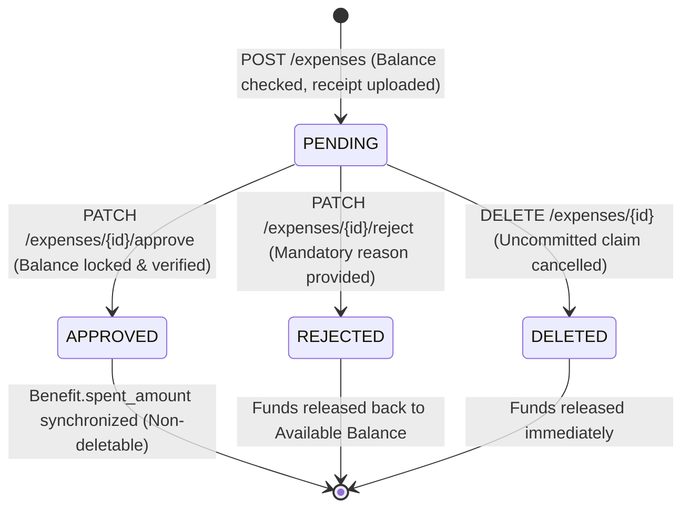

# Pluxee Enterprise HR Suite - Backend API

[](https://fastapi.tiangolo.com)
[](https://www.python.org/)
[](https://www.sqlalchemy.org/)
[](https://docs.pydantic.dev/)
[](https://cloudinary.com/)
[](https://firebase.google.com/docs/genkit)
[](https://pytest.org)
[](#license)

> **Version 1.0.0** — High-performance, enterprise-grade RESTful API engine powering employee flexible compensation, multi-tier benefit cap administration, automated expense validation, digital receipt archiving, and AI-driven executive financial diagnosis.

---

## Table of Contents

- [1. Overview & Business Context](#1-overview--business-context)
- [2. System Architecture & Tech Stack](#2-system-architecture--tech-stack)
- [3. Project Directory Structure](#3-project-directory-structure)
- [4. Transactional Integrity & Business Rules](#4-transactional-integrity--business-rules)
  - [4.1 Budget Hierarchy & Formulas](#41-budget-hierarchy--formulas)
  - [4.2 Expense Lifecycle & Approval Workflow](#42-expense-lifecycle--approval-workflow)
  - [4.3 Concurrency Control & Referential Integrity](#43-concurrency-control--referential-integrity)
- [5. API Reference (v1 Endpoints)](#5-api-reference-v1-endpoints)
  - [5.1 System & Health Checks](#51-system--health-checks)
  - [5.2 Company Global Budget](#52-company-global-budget)
  - [5.3 Benefit Categories Catalog](#53-benefit-categories-catalog)
  - [5.4 Employee Directory & 1-Click Budget](#54-employee-directory--1-click-budget)
  - [5.5 Employee Benefit Allocations](#55-employee-benefit-allocations)
  - [5.6 Expense Claims & Approvals](#56-expense-claims--approvals)
  - [5.7 Executive Dashboard KPIs](#57-executive-dashboard-kpis)
  - [5.8 AI Financial Advisor & Strategic Insights](#58-ai-financial-advisor--strategic-insights)
- [6. Getting Started & Installation](#6-getting-started--installation)
  - [6.1 Prerequisites](#61-prerequisites)
  - [6.2 Virtual Environment & Dependencies](#62-virtual-environment--dependencies)
  - [6.3 Environment Configuration (`.env`)](#63-environment-configuration-env)
  - [6.4 Database Initialization & Seeding](#64-database-initialization--seeding)
  - [6.5 Running the Server](#65-running-the-server)
- [7. Testing & Quality Assurance](#7-testing--quality-assurance)
- [8. Interactive API Documentation (OpenAPI / Swagger)](#8-interactive-api-documentation-openapi--swagger)
- [9. Error Handling & Standard Responses](#9-error-handling--standard-responses)

---

## 1. Overview & Business Context

**Pluxee Enterprise HR Suite** provides corporations with an agile, auditable platform to manage flexible employee compensation and corporate fringe benefits. The backend API serves as the single source of truth for:

1. **Flexible Remuneration Packaging**: Distributing gross annual salary into tax-advantaged benefit categories (Meals, Urban Transport, Professional Training, Health Insurance, Childcare, Fitness Memberships).
2. **Multi-Tier Limit Enforcement**: Guaranteeing that company-wide expenditure, departmental caps, employee-specific maximums, and category quotas cannot be overspent under any circumstance.
3. **Automated Expense Claims & Digital Proofs**: Ingesting expense submissions with attached digital receipts (PDF / image vouchers) uploaded securely to cloud storage.
4. **Approval State Machine**: Transitioning expense statuses (`PENDING` $\rightarrow$ `APPROVED` or `REJECTED`), executing real-time budget deductions, and maintaining transactional logs.
5. **AI Financial Co-Pilot**: Leveraging **Google Genkit** and the **Google Gemini** model family to continuously monitor portfolio solvency, detect high-utilization saturation risks ($>66\%$ and $>85\%$), and generate actionable HR reallocation strategies.

```
       +-------------------------------------------------------+
       |               Pluxee Enterprise Web UI                |
       |  (Dashboard, Employee Hub, Expenses, Benefit Modals)  |
       +---------------------------+---------------------------+
                                   | REST / JSON / Multipart
                                   v
+---------------------------------------------------------------------+
|                      FastAPI Application Gateway                    |
|  - CORS Security   - Request Logger   - Standardized Error Handling |
+----------------------------------+----------------------------------+
                                   |
         +-------------------------+-------------------------+
         |                         |                         |
         v                         v                         v
+------------------+     +-------------------+     +------------------+
| Domain Services  |     |   SQLAlchemy 2    |     |  Cloud Services  |
| - Expense Engine |     |  - SQLite Engine  |     |  - Cloudinary    |
| - Budget Guards  |     |  - PRAGMA FKs ON  |     |  - Google Genkit |
| - State Machine  |     |  - Row Locking    |     |    (Gemini LLM)  |
+------------------+     +-------------------+     +------------------+
```

---

## 2. System Architecture & Tech Stack

The service is built on modern, lightweight, and type-safe Python technologies:

| Technology | Role | Purpose & Implementation Details |
|:---|:---|:---|
| **Python 3.13 / 3.11+** | Language Runtime | Native asynchronous support, strong typing, pattern matching, and performance enhancements. |
| **FastAPI** `^0.115.0` | Web Framework | Declarative route handlers, asynchronous dependency injection, OpenAPI 3.1 spec generation. |
| **Uvicorn** `^0.30.0` | ASGI Server | High-throughput asynchronous server supporting worker processes and live file reload. |
| **SQLAlchemy** `^2.0.30` | ORM & Persistence | Declarative 2.0 mapping, eager loading (`selectinload`, `joinedload`), transactional row locking (`with_for_update()`). |
| **SQLite (`db.sqlite3`)** | Relational Database | Zero-configuration relational engine with connection-level foreign key enforcement via `PRAGMA foreign_keys=ON`. |
| **Pydantic v2** `^2.7.0` | Validation & Schemas | High-speed C-based model validation, input coercion, strict string normalization, and output serialization. |
| **Pydantic Settings** `^2.2.0` | Configuration Management | Strictly typed environment configuration loaded from `.env` files. |
| **Cloudinary** `^1.40.0` | Cloud Asset Storage | Digital receipt storage (images and PDFs) with folder-based partitioning (`pluxee_expenses`). |
| **Google Genkit** `^0.12.0` | AI Framework | Structured workflow orchestrator interfacing with Google GenAI Gemini models. |
| **Google Gemini** `gemini-2.0-flash` | Generative AI LLM | Executive financial diagnosis generation, consumption ratio analysis, and strategic optimization recommendations. |
| **Pytest** `^8.2.0` | Automated Testing | Comprehensive unit and integration test runner with in-memory database isolation and coverage reporting. |

---

## 3. Project Directory Structure

The project follows a clean, layered architectural pattern, enforcing separation of concerns between HTTP transports, business controllers, data schemas, database models, and third-party service adapters:

```
pluxee-backend/
├── config/
│   ├── __init__.py
│   └── config_variables.py     # Pydantic Settings: environment variables, CORS, Cloudinary, AI
├── database/
│   ├── __init__.py
│   ├── database.py             # SQLAlchemy engine, session maker, SQLite PRAGMA FK hooks, init_db()
│   └── seed.py                 # Automated database seeder with realistic fixtures & budgets
├── model/
│   ├── __init__.py             # Model exports for declarative metadata registry
│   ├── company_model.py        # Company entity: global corporate budget cap
│   ├── category_model.py       # Category entity: name, icon, color, budget cap, active status
│   ├── employee_model.py       # Employee entity: contact info, department, max_budget cap
│   ├── benefit_model.py        # Benefit junction: employee-category allocation & spent tracking
│   └── expense_model.py        # Expense claims: amount, concept, receipt_url, status, rejection_reason
├── schema/
│   ├── __init__.py
│   ├── company_schema.py       # Company budget validation & response schemas
│   ├── category_schema.py      # Category CRUD input validation & metrics projection
│   ├── employee_schema.py      # Employee inputs, budget updates, and nested detail schemas
│   ├── benefit_schema.py       # Benefit allocation request payloads and balance summaries
│   ├── expense_schema.py       # Expense query filters & rejection payload models
│   ├── dashboard_schema.py     # Executive KPI aggregate metrics schemas
│   └── ai_schema.py            # Genkit structured diagnosis contracts (Health, Alerts, Recommendations)
├── controller/
│   ├── __init__.py
│   ├── company_controller.py   # Global budget retrieval and cap updates
│   ├── category_controller.py  # Category lifecycle, uniqueness checks, global cap limits
│   ├── employee_controller.py  # Employee CRUD, nested metric aggregations, 1-click budget guards
│   ├── benefit_controller.py   # Category cup allocation, composite uniqueness, cap validations
│   ├── expense_controller.py   # Expense workflow (create, update, approve, reject), receipt upload
│   ├── dashboard_controller.py # Real-time aggregate metric calculations for executive views
│   └── ai_controller.py        # Genkit Gemini pipeline with local heuristic reasoning fallback
├── routes/
│   ├── __init__.py
│   ├── routes.py               # Root API v1 router mounting all operational sub-routers
│   ├── company_routes.py       # Endpoints: /api/v1/company/budget
│   ├── category_routes.py      # Endpoints: /api/v1/categories
│   ├── employee_routes.py      # Endpoints: /api/v1/employees & /api/v1/benefits
│   ├── expense_routes.py       # Endpoints: /api/v1/expenses
│   ├── dashboard_routes.py     # Endpoints: /api/v1/dashboard
│   └── ai_routes.py            # Endpoints: /api/v1/ai/insights
├── services/
│   ├── __init__.py
│   └── cloudinary_service.py   # Cloudinary SDK wrapper for receipt uploads and URL resolution
├── tests/
│   ├── __init__.py
│   ├── conftest.py             # Shared pytest fixtures, in-memory DB configuration
│   └── test_category_routes.py # Comprehensive suite validating category CRUD, caps, and integrity
├── db.sqlite3                  # Local SQLite database file (auto-generated)
├── main.py                     # FastAPI application factory, middleware, exception handlers
├── start_dev.py                # Integrated development launcher (Backend + Frontend + Browser)
├── start.bat                   # Quick-start script for Windows development environments
├── requirements.txt            # Locked project dependencies
├── .env.example                # Example environment variables template
└── README.md                   # Enterprise technical documentation
```

---

## 4. Transactional Integrity & Business Rules

### 4.1 Budget Hierarchy & Formulas

The financial engine implements strict hierarchical cap enforcement to eliminate overdrafts and guarantee corporate governance:

```
[ Corporate Global Budget (Company.global_budget) ]
                         │
                         ├───────────────────────────────────────────┐
                         ▼                                           ▼
          [ Category Budget Quotas ]                   [ Employee Max Budget Cap ]
           (e.g., Food: €15k, Health: €8k)             (e.g., Employee A: €2,500.00)
                                                                     │
                                                                     ▼
                                                      [ Benefit Category Allocations ]
                                                      - Meals:       €800.00
                                                      - Health:      €500.00
                                                      - Transport:   €300.00
                                                                     │
                                                                     ▼
                                                      [ Expense Claims Tracking ]
                                                      - Committed: PENDING + APPROVED
                                                      - Spent:     APPROVED only
```

#### Core Mathematical Invariants

1. **Category vs. Company Global Cap:**
   $$\sum_{i=1}^{N} \text{Category.budget}_i \le \text{Company.global\_budget}$$

2. **Employee Allocations vs. Employee Max Budget:**
   $$\sum_{j=1}^{M} \text{Benefit.allocated\_amount}_j \le \text{Employee.max\_budget}$$

3. **Committed Spending (Employee in a Category):**
   $$\text{Committed} = \sum \text{Expense.amount} \quad \forall \text{ Expense with status } \in \{\text{PENDING}, \text{APPROVED}\}$$

4. **Available Benefit Balance:**
   $$\text{Available} = \text{Benefit.allocated\_amount} - \text{Committed}$$
   *An expense claim is immediately rejected with `HTTP 409 Conflict` if $\text{Expense.amount} > \text{Available}$.*

5. **Real-time Synchronized Spent Amount:**
   $$\text{Benefit.spent\_amount} = \sum \text{Expense.amount} \quad \forall \text{ Expense with status } = \text{APPROVED}$$

6. **1-Click Budget Reduction Guard:**
   $$\text{New Employee.max\_budget} \ge \sum_{\text{All Categories}} \text{Committed}$$
   *An administrator cannot reduce an employee's total budget below expenses already committed or approved.*

---

### 4.2 Expense Lifecycle & Approval Workflow



- **Submission (`POST /expenses`)**: Validates that employee has an active `Benefit` record for the category. Verifies that `Expense.amount <= Available Balance`. Attaches uploaded ticket to Cloudinary. The claim enters `PENDING` status.
- **Approval (`PATCH /expenses/{id}/approve`)**: Re-checks that committed balance has not been violated under concurrent transactions using row-level locking (`with_for_update()`). Updates status to `APPROVED`. Calls `_recalculate_benefit_spent()` to flush exact totals into `Benefit.spent_amount`.
- **Rejection (`PATCH /expenses/{id}/reject`)**: Requires a non-empty `reason` string in payload. Changes status to `REJECTED`, storing `rejection_reason`. Instantly frees committed funds back into the employee's available balance.
- **Deletion (`DELETE /expenses/{id}`)**: Approved expenses **cannot** be deleted (`HTTP 409 Conflict`), preserving financial audit trails. Pending or rejected expenses can be safely purged.

---

### 4.3 Concurrency Control & Referential Integrity

- **SQLite PRAGMA Hooks**: SQLite by default ignores foreign key constraints. Pluxee Backend enforces integrity through an engine connection listener:
  ```python
  @event.listens_for(Engine, "connect")
  def set_sqlite_pragma(dbapi_connection, connection_record):
      cursor = dbapi_connection.cursor()
      cursor.execute("PRAGMA foreign_keys=ON")
      cursor.close()
  ```
- **Cascading Rules**:
  - `Employee` $\rightarrow$ `Benefit`: `ON DELETE CASCADE` ensures an employee purge cleanly removes allocations.
  - `Employee` $\rightarrow$ `Expense`: `ON DELETE CASCADE` removes historical claims.
  - `Category` $\rightarrow$ `Benefit` / `Expense`: `ON DELETE RESTRICT` prohibits dropping a category that holds active benefits or claims.
- **Pessimistic Locking**: For critical financial state changes (`create_expense`, `update_expense`, `approve_expense`), the engine applies `.with_for_update()` to ensure concurrent claims do not cause double-spend race conditions.

---

## 5. API Reference (v1 Endpoints)

All business endpoints are mounted under the `/api/v1` prefix.

### 5.1 System & Health Checks

| Method | Endpoint | Description | Auth | Response |
|:---|:---|:---|:---|:---|
| `GET` | `/` | Service metadata, environment, and Swagger quick links | Public | `200 OK` |
| `GET` | `/health` | System health probe (uptime, status) | Public | `200 OK` |
| `GET` | `/api/v1/status` | Operational status of the v1 API router | Public | `200 OK` |

---

### 5.2 Company Global Budget

| Method | Endpoint | Description | Query / Body | Response |
|:---|:---|:---|:---|:---|
| `GET` | `/api/v1/company/budget` | Get corporate global budget cap | None | `200 OK` |
| `PUT` | `/api/v1/company/budget` | Update corporate global budget cap | `{"global_budget": 75000.00}` | `200 OK` |

#### Example Request (`PUT /api/v1/company/budget`):
```json
{
  "global_budget": 85000.00
}
```

---

### 5.3 Benefit Categories Catalog

| Method | Endpoint | Description | Headers / Params | Response |
|:---|:---|:---|:---|:---|
| `GET` | `/api/v1/categories` | List active categories (benefits & expense count, total spent) | `?include_inactive=false` | `200 OK` |
| `GET` | `/api/v1/categories/{id}` | Retrieve specific category details | `id: int` | `200 OK` |
| `POST` | `/api/v1/categories` | Create new category (validates unique name and cap ceiling) | `X-Global-Budget-Cap` (opt) | `201 Created` |
| `PUT` | `/api/v1/categories/{id}` | Update category details and budget | `id: int`, `X-Global-Budget-Cap` | `200 OK` |
| `DELETE` | `/api/v1/categories/{id}` | Delete unused category (blocks if benefits or expenses exist) | `id: int` | `204 No Content` |

#### Example Category Creation Payload:
```json
{
  "name": "Guardería",
  "description": "Cheques guardería y conciliación familiar",
  "icon": "child_care",
  "color": "#F59E0B",
  "budget": 6000.00
}
```

---

### 5.4 Employee Directory & 1-Click Budget

| Method | Endpoint | Description | Params / Body | Response |
|:---|:---|:---|:---|:---|
| `GET` | `/api/v1/employees` | List all employees with calculated `total_allocated`, `total_spent`, and `available_budget` | None | `200 OK` |
| `GET` | `/api/v1/employees/{id}` | Detailed employee view with nested category benefits and expense history | `id: int` | `200 OK` |
| `POST` | `/api/v1/employees` | Register new employee (unique email validation) | `EmployeeCreate` | `201 Created` |
| `PUT` | `/api/v1/employees/{id}` | Update employee personal data | `id: int`, `EmployeeUpdate` | `200 OK` |
| `DELETE` | `/api/v1/employees/{id}` | Delete employee (cascades allocations and claims) | `id: int` | `204 No Content` |
| `PATCH` | `/api/v1/employees/{id}/budget` | **1-Click Editable Budget**: Updates total cap if $\ge$ committed spending | `id: int`, `{"max_budget": 2500.00}` | `200 OK` |

#### Example Employee Response (`GET /api/v1/employees/1`):
```json
{
  "id": 1,
  "first_name": "Ana",
  "last_name": "Gómez",
  "email": "ana.gomez@company.com",
  "department": "Tecnología",
  "position": null,
  "max_budget": "2500.00",
  "total_allocated": "1600.00",
  "total_spent": "820.50",
  "available_budget": "1679.50",
  "created_at": "2026-10-20T08:00:00Z",
  "updated_at": "2026-10-22T09:30:00Z",
  "benefits": [
    {
      "id": 1,
      "category_id": 1,
      "category_name": "Comida",
      "category_icon": "restaurant",
      "category_color": "#3B82F6",
      "allocated_amount": "800.00",
      "spent_amount": "520.50",
      "available_amount": "279.50",
      "updated_at": "2026-10-22T09:30:00Z"
    }
  ],
  "expenses": []
}
```

---

### 5.5 Employee Benefit Allocations

| Method | Endpoint | Description | Validation Constraints | Response |
|:---|:---|:---|:---|:---|
| `GET` | `/api/v1/employees/{id}/benefits` | List all assigned category benefits for an employee | Employee must exist | `200 OK` |
| `POST` | `/api/v1/employees/{id}/benefits` | Assign a category benefit cup to an employee | Unique `(employee, category)`, $\sum \text{allocated} \le \text{max\_budget}$ | `201 Created` |
| `PUT` | `/api/v1/benefits/{benefit_id}` | Modify allocated amount for a category benefit | $\text{new\_allocated} \ge \text{spent}$, total $\le \text{max\_budget}$ | `200 OK` |
| `DELETE` | `/api/v1/benefits/{benefit_id}` | Revoke benefit assignment | Only allowed if $\text{spent\_amount} = 0$ | `204 No Content` |

---

### 5.6 Expense Claims & Approvals

| Method | Endpoint | Description | Content-Type / Query | Response |
|:---|:---|:---|:---|:---|
| `GET` | `/api/v1/expenses` | List expenses with optional filters | `?status=pending&employee_id=1&search=Uber` | `200 OK` |
| `POST` | `/api/v1/expenses` | Submit new expense claim with receipt upload | `multipart/form-data` | `201 Created` |
| `PUT` | `/api/v1/expenses/{id}` | Edit a pending expense claim | `multipart/form-data` | `200 OK` |
| `PATCH` | `/api/v1/expenses/{id}/approve` | **Approve Claim**: locks row, confirms available balance, updates spent amount | `application/json` | `200 OK` |
| `PATCH` | `/api/v1/expenses/{id}/reject` | **Reject Claim**: stores mandatory justification, releases balance | `{"reason": "Factura ilegible"}` | `200 OK` |
| `DELETE` | `/api/v1/expenses/{id}` | Delete pending/rejected claim (approved claims are locked) | `id: int` | `200 OK` |
| `GET` | `/api/v1/expenses/employees/{id}/balance` | Real-time balance check for employee in category | `?categoryId=1` | `200 OK` |
| `GET` | `/api/v1/expenses/categories` | Lightweight category dropdown list | None | `200 OK` |

#### Multipart Form Fields for `POST /api/v1/expenses`:
- `employeeId` (int, required): ID of submitting employee.
- `categoryId` (int, required): ID of benefit category.
- `concept` (str, required): Detailed description of expense.
- `amount` (float, required): Expense total (> 0.00).
- `date` (date, required): Format `YYYY-MM-DD`.
- `receipt` (file, optional): Uploaded digital invoice or ticket (`.pdf`, `.png`, `.jpg`).

---

### 5.7 Executive Dashboard KPIs

| Method | Endpoint | Description | Response Model |
|:---|:---|:---|:---|
| `GET` | `/api/v1/dashboard/stats` | Global metrics: Total Budget, Allocated, Total Spent, Available, Employee Count, Pending Claims | `DashboardStatsSchema` |
| `GET` | `/api/v1/dashboard/recent-employees` | Top recent employees with departmental spending breakdown | `List[RecentEmployeeSchema]` |
| `GET` | `/api/v1/dashboard/categories` | Category consumption summary with percentage metrics | `List[CategoryStatsSchema]` |

---

### 5.8 AI Financial Advisor & Strategic Insights

| Method | Endpoint | Description | LLM Integration |
|:---|:---|:---|:---|
| `POST` | `/api/v1/ai/insights` | Generates a 3-part diagnosis: Overall Health, Threshold Alerts (>66% & >85%), and Reallocation Advice | **Google Genkit** (`gemini-2.0-flash`) with Heuristic Fallback |

#### Sample AI Response Contract (`BudgetInsightsResponse`):
```json
{
  "success": true,
  "source": "google-genkit-advisor-v1",
  "timestamp": "2026-10-22T10:15:30.123456Z",
  "health": {
    "status": "warning",
    "spent": 28450.00,
    "limit": 45000.00,
    "available": 16550.00,
    "ratio": 63.2,
    "summaryText": "La cartera corporativa se encuentra en nivel de advertencia con un 63.2% del presupuesto consumido (€28,450.00 de €45,000.00)."
  },
  "alerts": [
    {
      "id": "alert-cat-1",
      "type": "category",
      "name": "Comida",
      "percentage": 88.5,
      "metric": "€13,275.00 / €15,000.00",
      "severity": "critical"
    }
  ],
  "recommendations": {
    "summaryText": "Reasignar excedentes desde categorías subutilizadas (Guardería, Gimnasio) hacia Comida y Transporte para evitar bloqueo de gastos en fin de trimestre.",
    "underutilized": ["Guardería", "Gimnasio"],
    "saturated": ["Comida"]
  }
}
```

---

## 6. Getting Started & Installation

### 6.1 Prerequisites

- **Python 3.11, 3.12, or 3.13** installed.
- **Git** version control.
- Free or standard **Cloudinary** account (for digital receipts).
- **Google Gemini API Key** (optional, recommended for Genkit AI insights; if omitted, the backend seamlessly falls back to its deterministic heuristic diagnosis engine).

---

### 6.2 Virtual Environment & Dependencies

1. **Clone the repository and enter the backend directory**:
   ```bash
   git clone https://github.com/your-org/pluxee-enterprise-suite.git
   cd pluxee-backend
   ```

2. **Create a dedicated virtual environment**:
   ```bash
   python -m venv .venv
   ```

3. **Activate the virtual environment**:
   - **Windows (PowerShell)**:
     ```powershell
     .\.venv\Scripts\Activate.ps1
     ```
   - **Windows (Command Prompt)**:
     ```cmd
     .\.venv\Scripts\activate.bat
     ```
   - **macOS / Linux**:
     ```bash
     source .venv/bin/activate
     ```

4. **Install project dependencies**:
   ```bash
   pip install --upgrade pip
   pip install -r requirements.txt
   ```

---

### 6.3 Environment Configuration (`.env`)

Copy the `.env.example` template to `.env`:

```bash
cp .env.example .env
```

Review and adjust settings according to your local environment:

| Variable | Type | Default Value | Description |
|:---|:---|:---|:---|
| `PORT` | int | `8000` | HTTP listening port for FastAPI / Uvicorn. |
| `HOST` | str | `0.0.0.0` | Network binding interface. |
| `ENVIRONMENT` | str | `development` | Deployment mode (`development`, `staging`, `production`). |
| `DEBUG` | bool | `True` | Enables auto-reload and verbose logging in development. |
| `DATABASE_URL` | str | `sqlite:///./db.sqlite3` | SQLAlchemy database connection URI. |
| `CORS_ORIGINS` | str / list | `http://localhost:5173,...` | Comma-separated allowed frontend origins. |
| `CLOUDINARY_CLOUD_NAME` | str | `""` | Cloudinary cloud identifier for digital receipts. |
| `CLOUDINARY_API_KEY` | str | `""` | Cloudinary API Key. |
| `CLOUDINARY_API_SECRET` | str | `""` | Cloudinary API Secret. |
| `GEMINI_API_KEY` | str | `""` | Google AI Studio API Key for Gemini LLM. |
| `GENKIT_MODEL` | str | `googleai/gemini-2.0-flash` | Genkit model identifier for AI recommendations. |
| `CATEGORY_GLOBAL_BUDGET_CAP` | Decimal | `45000.00` | Default header fallback for total category cap. |

---

### 6.4 Database Initialization & Seeding

The application automatically verifies and creates SQLite tables on startup via FastAPI's `lifespan` handler. If the database is empty, default fixtures are automatically seeded.

To explicitly recreate the schema and load the complete corporate test dataset (10 employees, 6 categories, benefit allocations, sample expenses):

```bash
python database/seed.py
```

Output:
```text
[*] Iniciando el proceso de seeding de la base de datos...
[*] Recreando esquema de base de datos via SQLAlchemy metadata...
[+] Configurando presupuesto corporativo global...
[+] Insertando categorías de beneficios con presupuestos entre 5.000 y 15.000 EUR...
[+] Registrando empleados en departamentos exclusivos (Tecnología, Marketing, RRHH, Ventas)...
[+] Asignando beneficios por categoría y vinculando gastos...
[OK] Base de datos poblada exitosamente con métricas verificadas.
```

---

### 6.5 Running the Server

#### Option A: Direct Uvicorn ASGI Server (Backend Only)
```bash
uvicorn main:app --host 0.0.0.0 --port 8000 --reload
```
The API becomes available at `http://localhost:8000`.

#### Option B: Unified Development Launcher (Backend + Frontend)
Pluxee provides an integrated orchestration script that boots both the FastAPI backend and the static frontend, monitors ports, and automatically opens your web browser:

```bash
python start_dev.py
```

*Options for `start_dev.py`:*
- `--backend-port 8000`: Specify custom port for FastAPI.
- `--frontend-port 5500`: Specify custom port for static UI server.
- `--no-browser`: Suppress automatic browser launch.

#### Option C: Windows Batch Launcher
```cmd
start.bat
```

---

## 7. Testing & Quality Assurance

The test suite runs under `pytest` and utilizes in-memory SQLite instances (`sqlite://`) with isolated session lifecycles, ensuring zero side-effects on development data.

### Executing Tests
```bash
# Using active virtual environment
pytest -v

# Or directly through the virtual environment python interpreter
.\.venv\Scripts\pytest -v
```

### Running Tests with Coverage Report
```bash
pytest --cov=. --cov-report=term-missing
```

### What the Test Suite Verifies
- **Category CRUD & Constraints**: Validates name normalization, duplicate name conflicts (`HTTP 409`), zero/negative budget rejection (`HTTP 422`), and global cap bounds.
- **Referential Integrity**: Proves that categories linked to active benefits or expenses cannot be deleted (`HTTP 409 Conflict`).
- **Pydantic Validation**: Checks that malformed request bodies produce standardized HTTP 422 validation envelopes.

---

## 8. Interactive API Documentation (OpenAPI / Swagger)

Once the backend is running, FastAPI provides auto-generated, interactive API documentation out of the box:

- **Swagger UI**: [`http://localhost:8000/docs`](http://localhost:8000/docs)  
  *Features full interactive endpoint execution, schema inspection, parameter description, and file upload testing.*
- **ReDoc**: [`http://localhost:8000/redoc`](http://localhost:8000/redoc)  
  *Clean, searchable, publication-ready API reference documentation.*
- **OpenAPI Schema (JSON)**: [`http://localhost:8000/openapi.json`](http://localhost:8000/openapi.json)

---

## 9. Error Handling & Standard Responses

All application exceptions are intercepted by centralized middleware in `main.py` to ensure consistent, predictable JSON contracts across all HTTP status codes:

### Standard Error Contract
```json
{
  "success": false,
  "detail": "Error description message",
  "errors": []
}
```

### HTTP Status Code Catalog

| Code | Label | Typical Trigger |
|:---|:---|:---|
| `200 OK` | Success | Successful retrieval, modification, or expense approval. |
| `201 Created` | Resource Created | Employee, category, benefit assignment, or expense claim created. |
| `204 No Content` | Deleted | Category or benefit deleted with no response body. |
| `400 Bad Request` | Bad Request | Zero or negative expense amount, empty rejection reason. |
| `404 Not Found` | Not Found | Employee, category, benefit, or expense ID does not exist. |
| `409 Conflict` | Conflict | Email collision, category name collision, insufficient balance for expense, deleting locked category or approved expense. |
| `422 Unprocessable` | Unprocessable Content | Budget cap reduction lower than committed spending, exceeding global cap, schema validation errors. |
| `500 Server Error` | Internal Server Error | Unhandled runtime exception; logs stack trace to server logger. |

---

## License

Copyright © 2026 Pluxee Enterprise HR Suite. All rights reserved.  
Confidential and Proprietary.
